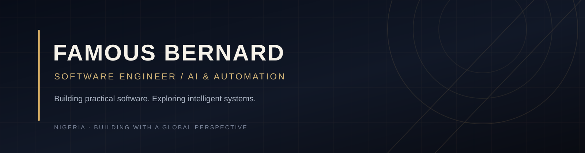

<!--
  Profile README for github.com/Famous3262
  Visual direction: dark, minimal, premium.
-->

### Software Engineer · AI & Automation Enthusiast · Tech Entrepreneur

Building practical software and exploring how AI can make useful products smarter.

[GitHub](https://github.com/Famous3262) · [Repositories](https://github.com/Famous3262?tab=repositories)

---

## About

I'm a Nigerian software developer with a background in business management and a strong interest in building technology-driven solutions.

I work across web and application development, and I'm exploring practical applications of artificial intelligence and workflow automation. I enjoy learning by building, understanding how systems work, and turning real problems into useful digital products.

- **Development:** Web applications, APIs and software fundamentals
- **AI & automation:** LLM-powered applications, AI agents and workflow automation
- **Product interests:** Developer tools, business software and technology for emerging markets
- **Approach:** Practical, curious and continuously learning

## Technologies

*Technologies I work with, learn and explore — not a claim of equal proficiency across every tool.*

## Selected Work

### [Simple Shell](https://github.com/Famous3262/simple_shell)
A collaborative C project to build a simple UNIX command-line interpreter. The repository documents the project requirements, compilation command and supported system calls.

### [ALX Software Engineering Coursework](https://github.com/Famous3262?tab=repositories)
A collection of programming and systems-engineering exercises covering areas such as C, Python, JavaScript, backend development, algorithms and Linux.

## Development Projects

### [GlowMeal — Meal Planner](https://github.com/Famous3262/Meal-Planner)
A React Native and Expo application with onboarding, daily meal planning, recipe browsing, a weekly timetable and a grocery-list view. The project is under active development.

### [White Dominion](https://github.com/Famous3262/white_dominion)
An early-stage Next.js codebase exploring an AI-assisted fashion product concept. The repository is currently a development scaffold; the full product is not yet complete.

> I feature projects according to their actual implementation status. Planned ideas are not presented as completed software.

## Current Interests

- Full-stack application development
- AI-assisted software and LLM integrations
- AI agents and workflow automation
- Backend architecture, APIs and databases
- Building useful products for businesses and emerging markets

## Connect

- **GitHub:** [@Famous3262](https://github.com/Famous3262)
- **Location:** Nigeria

---

*Build with purpose. Learn continuously. Ship thoughtfully.*

